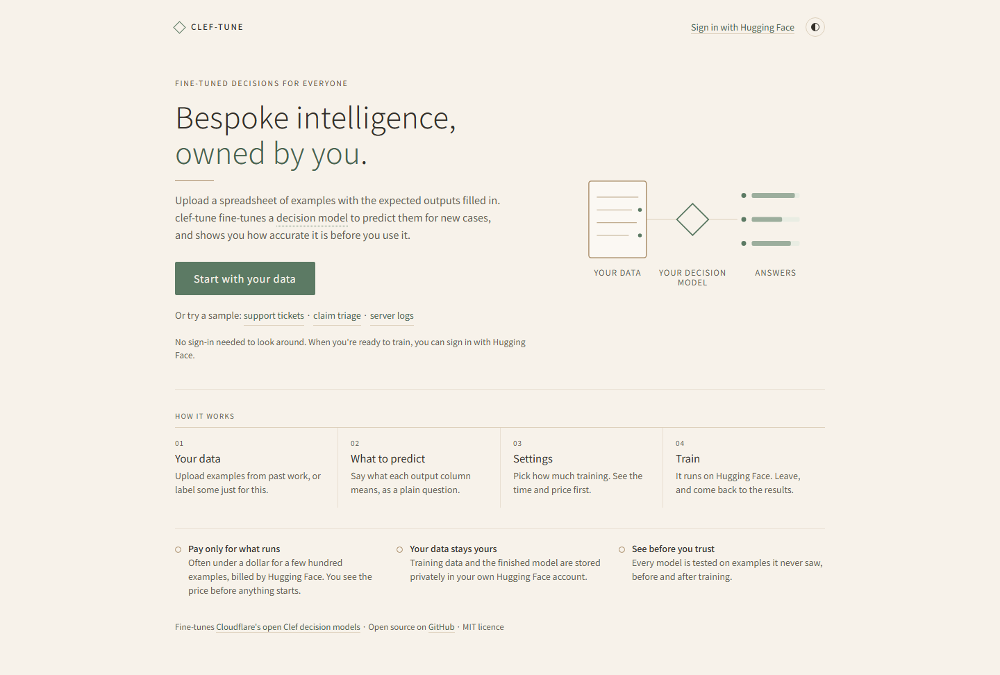
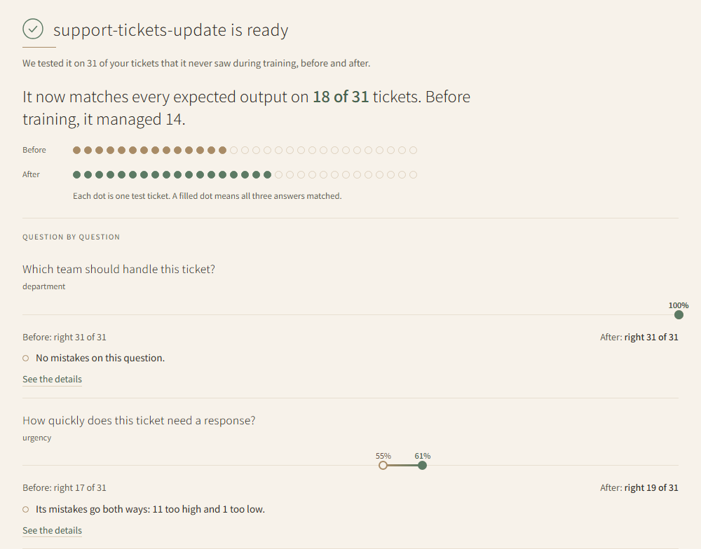

# clef-tune

Fine-tune Cloudflare's [Clef](https://huggingface.co/Cloudflare/clef) decision models (Clef 27B
and Clef-Flash 9.4B) on your own labeled spreadsheet. Use the web UI, or the CLI on your own GPU
or on [Hugging Face Jobs](https://huggingface.co/docs/huggingface_hub/guides/jobs).

[](https://huggingface.co/spaces/hvgupta1/clef-tune)

**Try it with nothing to install: [clef-tune on Hugging Face Spaces](https://huggingface.co/spaces/hvgupta1/clef-tune).**
Sign in with Hugging Face, and training runs on your own account and credits.

[](https://huggingface.co/spaces/hvgupta1/clef-tune)

## Install

```bash
uv pip install "clef-tune[ui] @ git+https://github.com/hersh-gupta/clef-tune"
```

To train on this machine's GPU, also install the `train` extra (see
[Train on your own GPU](#train-on-your-own-gpu)).

clef-tune finds your Hugging Face token the way `huggingface_hub` does: from `HF_TOKEN`, or from
the login saved by `hf auth login`. Pushing a model needs `repo.write`; Jobs also need
`job.write`. Keep the token out of `config.yaml`; a `.env` file (git-ignored here) works with
`uv run --env-file .env ...`.

## Web UI

```bash
clef-tune ui        # http://localhost:7860
```

Upload a spreadsheet of examples with the expected outputs filled in (CSV, TSV, Excel, JSONL, or
a zip with images). Say what each column is for, turn each expected output into a question, and
start. The UI shows the time and the most a run can cost before it starts. It trains on Hugging
Face Jobs, so you can close the page and come back. Results are reported in plain words. A
finished model can then fill in the answers for a new spreadsheet. Three samples let you try it
without your own data.



The UI answers only to `localhost`. `--host 0.0.0.0` opens it, and this computer's Hugging Face
login, to your whole network.

### As a Hugging Face Space

On a Space, each visitor signs in with Hugging Face and runs jobs on their own account and
credits. The Space installs clef-tune from GitHub at an exact commit, so push first:

```bash
git push
python scripts/prepare_space.py build/space
hf upload <you>/clef-tune build/space . --repo-type space
```

## CLI

A config describes your data and questions; see
[`examples/support_tickets.yaml`](examples/support_tickets.yaml).

```bash
clef-tune validate cfg.yaml                      # bad labels, duplicate IDs, over-long rows
clef-tune estimate cfg.yaml                      # time and cost on each GPU
clef-tune validate cfg.yaml --bundle out/bundle  # portable data + config, to train anywhere
```

### Train on your own GPU

```bash
uv sync --extra train                            # CUDA torch; from git, add --torch-backend cu130
clef-tune train cfg.yaml                         # resumes from checkpoints; --push-to-hub REPO
accelerate launch -m clef_tune train cfg.yaml    # several GPUs
clef-tune predict out/<run>/final new.csv -o preds.csv
clef-tune eval out/<run>/final labeled.csv
clef-tune export out/<run>/final --merge -o merged
```

On Linux, the linear-attention kernels make training much faster. Build them against the torch
you already have, because an isolated build makes model loading crash:

```bash
pip install --no-build-isolation causal-conv1d==1.7.0 flash-linear-attention==0.6.0
```

There is also a Dockerfile:
`docker build -t clef-tune .`, then `docker run --gpus all -v "$PWD:/work" -w /work clef-tune train cfg.yaml`.

### Train on Hugging Face Jobs

You need a token with `repo.write` and `job.write`, prepaid
[Jobs credits](https://huggingface.co/settings/billing), and a clean checkout whose commit is on
GitHub (the job installs that exact commit).

```bash
clef-tune jobs launch cfg.yaml    # shows hardware, time and the most it can cost, then asks
clef-tune jobs list
clef-tune jobs status <job-id>
clef-tune jobs logs <job-id> -f
clef-tune jobs cancel <job-id>    # can take a minute to stop
clef-tune jobs resume <job-id>    # continue from the newest checkpoint
clef-tune jobs clean <job-id>     # remove files a finished job left behind
```

The data goes to your private `<you>/jobs-artifacts` bucket, and the model to a private repo
(`<you>/clef-tune-<run_name>` by default). The timeout caps the cost.

## Python

```python
from clef_tune import Predictor

p = Predictor.load("out/<run>/final")  # local folder or Hub repo
p.predict([{"state": {"subject": "Site down", "body": "..."}}])
```

Answers are calibrated with one temperature per question, stored in the model's
`calibration.json`. A merged export served with SGLang returns uncalibrated probabilities.

## Data

- **CSV, TSV, Excel:** one row per example. `data.state_columns` are the input, and each
  question has a column with the expected output. An empty cell means unlabeled.
- **JSONL:** flat rows work the same way. Rows in Clef's own format
  (`{"id", "state", "labels", ...}`) are read as-is, soft labels included.

## Development

```bash
uv sync --extra dev
uv run pytest
```

For a plain-language explainer of what fine-tuning changes, see
[How fine-tuning works](docs/how-fine-tuning-works.md).
