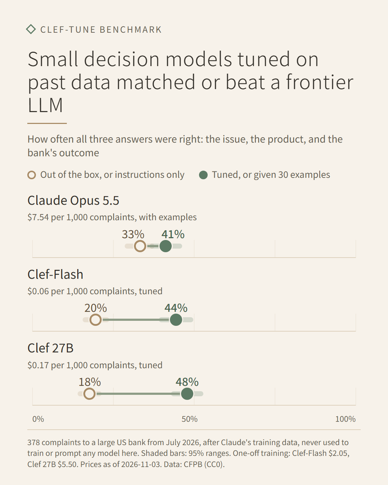

# Benchmark: fine-tuned Clef against a frontier LLM, on real bank complaints

**The question:** if you have a few thousand past decisions, does a small decision model tuned on
them with clef-tune beat a frontier LLM that is simply told what to do, and what does each cost?

**The short answer:**

- **Clef 27B:** after tuning on 3,000 past complaints, it got all three answers right on 47.9% of
  new ones. Claude Opus 5.5 given 30 worked examples got 41.3%.
- **Clef-Flash:** the smaller model tied with Claude (44.4%).
- **Cost:** both ran for a few cents per 1,000 complaints, against about $7.50 for Claude.
- **Out of the box:** neither Clef model came close. The gain comes from the tuning.

Everything here can be rerun from public data with the scripts in [`cfpb/`](cfpb/).



## The data

Real consumer complaints sent to the US Consumer Financial Protection Bureau (CFPB) about one large
US bank, Bank of America, in the consumer's own words. The data is public and CC0. For each
complaint, there are three things to predict:

| Question | Choices | Where the label comes from |
|---|---|---|
| What is this complaint mainly about? | 7 common issues, plus "other" | the issue the consumer picked on the CFPB form |
| Which product is it about? | checking or savings account, credit card, money transfer | the product the consumer picked |
| How did the bank close it? | explanation only, fix without money, money back | the bank's recorded response |

The third question is the bank's own decision. It follows the bank's internal policy, which no
prompt spells out, so it is the kind of decision where tuning on past cases should help.

**Scope:** checking and savings accounts, credit cards and money transfers. Credit reports, debt
collection, loans and mortgages are left out, so no complaint is a credit decision. Only complaints
with published text and a final response are used.

**Split by date**, so the test is "learn from the past, decide the future":

- **Training:** 3,000 complaints received from January 2025 to May 2026, a seeded random sample.
- **Validation:** 300 more from the same months. Clef uses them to pick its best checkpoint and to
  calibrate its confidence. The Claude prompt's format was checked on 50 of them.
- **Test:** all 378 qualifying complaints received in July 2026. They were never used for training,
  examples or prompt changes.
  - June 2026 is skipped because it is the month of current Claude models' training-data cutoff,
    so no test complaint could have been in Claude's training data.
  - The CFPB stopped publishing complaint text on 14 August 2026, and none from August had been
    published, which is why the test set is one month.
- 11 training-month complaints longer than 12,000 characters were dropped, the same rule for every
  model. None in July were that long.

The prepared files are on the Hub as
[hvgupta1/cfpb-bank-complaints-benchmark](https://huggingface.co/datasets/hvgupta1/cfpb-bank-complaints-benchmark).

## The contenders

| Contender | Setup |
|---|---|
| Clef-Flash (9B), out of the box | Cloudflare's released model, untrained: exactly what training starts from |
| Clef-Flash, tuned | clef-tune's Balanced preset (LoRA, 3 passes) on the 3,000 training complaints |
| Clef 27B, out of the box | as above |
| Clef 27B, tuned | as above |
| Claude Opus 5.5, instructions only | the same questions and choice descriptions Clef gets, plus the complaint |
| Claude Opus 5.5, with examples | the same, plus 30 training complaints with their answers |

**To keep it fair:**

- Every contender sees only the complaint text, and the same wording for each question and
  choice.
- Claude's answers are held to the allowed choices with structured outputs. It runs at its default
  effort (medium), with no fallback to another model.
- The 30 examples are a seeded random draw from the training set, redrawn only until every choice
  appears at least once. They were not hand-picked.
- The Claude prompt was written once and not tuned. The 50-row format check found no problems, so
  it was not changed.
- Each contender ran once, and every number is reported.

## Results

The test set is the 378 complaints received in July 2026. The ranges are 95% bootstrap ranges from
2,000 resamples of those complaints.

| Contender | All three right | Issue | Product | Outcome |
| --- | --- | --- | --- | --- |
| Claude Opus 5.5, instructions only | **33.3%** (28.6–37.8) | 56.1% | 91.8% | 64.0% |
| Claude Opus 5.5, with examples | **41.3%** (36.2–46.3) | 60.8% | 91.3% | 68.0% |
| Clef-Flash, out of the box | **19.6%** (15.6–23.8) | 43.7% | 86.5% | 51.1% |
| Clef-Flash, tuned | **44.4%** (39.2–49.7) | 69.8% | 91.0% | 65.3% |
| Clef 27B, out of the box | **17.7%** (14.0–21.4) | 38.1% | 87.3% | 52.4% |
| Clef 27B, tuned | **47.9%** (42.9–52.9) | 70.1% | 92.6% | 68.3% |

**What the numbers say:**

- **Tuned Clef 27B beat Claude with examples** by 6.6 points (95% range +1.6 to +11.9).
- **Tuned Clef-Flash tied with Claude with examples:** +3.2 points, with a range of −2.1 to +9.0
  that includes zero.
- **Both tuned models clearly beat Claude given instructions only**, by 11.1 and 14.6 points.
- **Tuning is what did it.** Out of the box, both Clef models were far behind (20% and 18%), and
  tuning added 25 and 30 points.
- **The biggest gain was on the issue**, "what is this complaint mainly about": 70% against 61%.
  The CFPB's issue categories have fine lines between them, and learning those from past cases
  helped more than describing them.
- **On the bank's outcome:**
  - Tuned Clef 27B matched Claude with examples (68.3% against 68.0%), and Clef-Flash was a little
    lower (65.3%).
  - Neither tuned model learned the rare "fix without money" outcome: 11 of the 378 test
    complaints, and about 4% of the training data. Claude with examples got 5 of those 11, which is
    why Claude has the higher outcome macro-F1 below.
  - Training with `class_weighting: balanced` might help with that, but this benchmark used each
    preset as it ships.

Paired differences in "all three right" use the same resamples for both contenders:

| Comparison | Difference | 95% range |
| --- | --- | --- |
| Clef 27B, tuned vs Claude Opus 5.5, with examples | +6.6 points | +1.6 to +11.9 |
| Clef-Flash, tuned vs Claude Opus 5.5, with examples | +3.2 points | −2.1 to +9.0 |
| Clef 27B, tuned vs Claude Opus 5.5, instructions only | +14.6 points | +9.3 to +19.6 |
| Clef-Flash, tuned vs Claude Opus 5.5, instructions only | +11.1 points | +5.3 to +16.9 |
| Clef 27B, tuned vs out of the box | +30.2 points | +24.6 to +35.7 |
| Clef-Flash, tuned vs out of the box | +24.9 points | +19.0 to +30.7 |
| Claude Opus 5.5, with examples vs instructions only | +7.9 points | +4.0 to +11.9 |

**Macro-F1 and calibration.** Macro-F1 averages over each question's choices, so rare choices
count as much as common ones. Calibration error measures how far a model's confidence is from how
often it is right; lower is better. For Clef it comes from its probabilities, after calibration on
the validation rows. For Claude it comes from its stated confidence.

| Contender | Issue F1 | Product F1 | Outcome F1 | Calibration error (issue / product / outcome) |
| --- | --- | --- | --- | --- |
| Claude Opus 5.5, instructions only | 0.492 | 0.891 | 0.496 | 0.135 / 0.075 / 0.055 |
| Claude Opus 5.5, with examples | 0.561 | 0.883 | 0.562 | 0.089 / 0.074 / 0.086 |
| Clef-Flash, out of the box | 0.437 | 0.838 | 0.275 | 0.191 / 0.068 / 0.230 |
| Clef-Flash, tuned | 0.660 | 0.882 | 0.427 | 0.072 / 0.031 / 0.067 |
| Clef 27B, out of the box | 0.364 | 0.848 | 0.311 | 0.335 / 0.063 / 0.162 |
| Clef 27B, tuned | 0.643 | 0.905 | 0.448 | 0.060 / 0.031 / 0.034 |

Tuned Clef's confidence was the better guide to when it was right. That is useful for deciding
which answers a person should review.

Clef's scores here match `clef-tune eval`'s own reports exactly; the scorer checks this.

## Cost and speed

All prices are list prices on 3 November 2026.

| Contender | Cost per 1,000 complaints | Complaints per minute | One-off training |
| --- | --- | --- | --- |
| Claude Opus 5.5, instructions only | $8.04 ($4.02 with the Batch API) | 166 | – |
| Claude Opus 5.5, with examples | $7.54 ($3.77 with the Batch API) | 230 | – |
| Clef-Flash, tuned | $0.06 | 738 | $2.05 (45 minutes) |
| Clef 27B, tuned | $0.17 | 266 | $5.50 (2.0 hours) |

- **Claude:** the cost is the billed tokens at $4 per million input, $20 per million output and
  $0.20 per million cached input, with thinking counted as output. The examples are cached, which
  is why the with-examples version costs a little less. Speed was measured with 8 requests at a
  time. The median was about 2 seconds per complaint. Batch prices are worked out, not run.
- **Clef:**
  - The cost is the GPU time while scoring, on one RTX Pro 6000 at $2.75 an hour on Hugging Face
    Jobs.
  - Starting a job takes a few minutes, for installing and loading the model, which adds about
    $0.50 to a one-off batch.
  - At that rate, training plus scoring pays for itself against Claude after roughly 350 (Flash)
    to 800 (27B) complaints.
- **Total spent on this benchmark:**
  - About $9.50 on Hugging Face Jobs, including a failed attempt on an H200 ($0.63) and a scoring
    job cancelled during setup.
  - $6.69 on the Claude API, including the 50-row format check.

## Limits

- **One bank and one kind of decision.** Other banks, other decisions and other data may come out
  differently.
- **One test month, 378 complaints.** The 95% ranges are about ±5 points on "all three right", so
  small differences don't mean much. The paired comparisons above account for that.
- **Noisy labels.** The issue and product are picked by consumers, who sometimes pick the wrong
  one. The outcome is what the bank recorded, not a judgement of what was right.
- **One run per contender.** Training and Claude's answers both vary a little from run to run.
- **Claude's confidence is self-reported** (a 0–100 number it states), not a probability.
  Calibration is compared on that basis.
- **Prices are list prices on 3 November 2026**, for Hugging Face Jobs and the Claude API. Clef's
  cost per 1,000 complaints counts only GPU time while scoring, at the hourly price. Starting a
  machine takes a few minutes, which matters for small batches.
- **Clef's own training data isn't published.** The test month comes after Claude's training-data
  cutoff; Cloudflare doesn't say when Clef's training data ends.
- The video's UI scenes show the same data and the real run's numbers in the clef-tune web app. The
  runs themselves were launched with the command line.

## Rerun it

From the repository root, with `uv sync --extra dev --extra train --extra ui --extra benchmark`,
an `HF_TOKEN` with write access and job credits, and an `ANTHROPIC_API_KEY`:

```bash
uv run python benchmarks/cfpb/fetch.py list
uv run python benchmarks/cfpb/fetch.py download --yes
uv run python benchmarks/cfpb/fetch.py labels
uv run python benchmarks/cfpb/prepare.py pool
uv run python benchmarks/cfpb/prepare.py split
uv run clef-tune validate benchmarks/cfpb/data/prepared/cfpb_flash.yaml
uv run python benchmarks/cfpb/clef_jobs.py check-test
uv run clef-tune estimate benchmarks/cfpb/data/prepared/cfpb_flash.yaml
uv run clef-tune jobs launch benchmarks/cfpb/data/prepared/cfpb_flash.yaml --flavor rtx-pro-6000 --timeout 120m
uv run clef-tune jobs launch benchmarks/cfpb/data/prepared/cfpb_27b.yaml --flavor rtx-pro-6000 --timeout 240m
uv run python benchmarks/cfpb/claude_arm.py estimate
uv run python benchmarks/cfpb/claude_arm.py run zero
uv run python benchmarks/cfpb/claude_arm.py run few
uv run python benchmarks/cfpb/claude_arm.py export zero
uv run python benchmarks/cfpb/claude_arm.py export few
uv run python benchmarks/cfpb/clef_jobs.py score flash --yes
uv run python benchmarks/cfpb/clef_jobs.py score 27b --timeout 90m --yes
uv run python benchmarks/cfpb/clef_jobs.py download flash
uv run python benchmarks/cfpb/clef_jobs.py download 27b
uv run python benchmarks/cfpb/score.py costs
uv run python benchmarks/cfpb/score.py score
uv run python benchmarks/cfpb/chart.py
uv run python benchmarks/cfpb/video/make_video.py fetch-run
uv run python benchmarks/cfpb/video/make_video.py video
uv run python benchmarks/cfpb/video/make_video.py gif
```

Each step saves its outputs and can be rerun on its own. The training jobs install clef-tune from
GitHub at commit `af1a9a4`.

**Two things to know about the hardware:**

- Training failed on an H200, because the fast attention kernels' training step refuses to run on
  Hopper GPUs with this Triton version. The runs used an RTX Pro 6000 (Blackwell) instead.
- A timeout like `2.5h` puts a dot in a job label, which Hugging Face rejects, so the commands use
  minutes.

Committed outputs in [`cfpb/results/`](cfpb/results/):

- `results.md`, `results.csv` and `metrics.json`: the numbers, including the ranges and paired
  differences.
- `costs.json`: prices and measured times.
- `answers/`: every contender's answer, confidence and the truth for each test complaint.
- `chart.png`, `video.mp4` and `benchmark.gif`.
